# Cómo funciona la app por dentro

Qué pasa desde que haces clic en el navegador hasta que ves la página: el camino de una
request por el servidor, cómo se arma el HTML, cómo llegan el CSS y el JavaScript, y cómo
Hotwire (Turbo y Stimulus) hace que una app renderizada en el servidor se sienta como una
SPA.

Los ejemplos son de esta app. Los diagramas usan [Mermaid](https://mermaid.js.org); GitHub
y VS Code (con una extensión de Mermaid) los muestran como gráficos.

## Índice

1. [La idea central](#1-la-idea-central)
2. [El viaje de una request](#2-el-viaje-de-una-request)
3. [Cómo se arma el HTML](#3-cómo-se-arma-el-html)
4. [Qué hace el navegador con ese HTML](#4-qué-hace-el-navegador-con-ese-html)
5. [Turbo Drive: navegar sin recargar](#5-turbo-drive-navegar-sin-recargar)
6. [Formularios: guardar, redirigir o mostrar errores](#6-formularios-guardar-redirigir-o-mostrar-errores)
7. [Turbo Frames: reemplazar una parte](#7-turbo-frames-reemplazar-una-parte)
8. [Turbo Streams: varias actualizaciones en una respuesta](#8-turbo-streams-varias-actualizaciones-en-una-respuesta)
9. [Stimulus: el JavaScript de cada componente](#9-stimulus-el-javascript-de-cada-componente)
10. [CSS y JavaScript: de dónde salen](#10-css-y-javascript-de-dónde-salen)
11. [Los packs dentro del flujo](#11-los-packs-dentro-del-flujo)
12. [Cómo leer lo que pasa](#12-cómo-leer-lo-que-pasa)

---

## 1. La idea central

**El servidor genera el HTML completo y el navegador solo lo muestra.** No hay una API JSON
ni una app de React que pida datos y arme la página en el navegador: Rails consulta la base
de datos, rellena plantillas ERB y devuelve HTML listo.

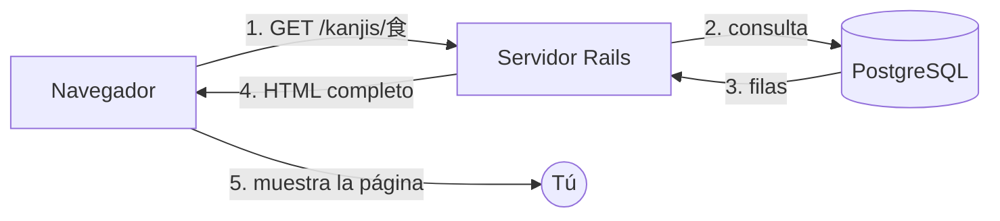

Lo que agrega Hotwire es **cómo** se pide y se reemplaza ese HTML: sin recargar la página
entera (Turbo) y con un poco de JavaScript para lo que necesita reaccionar al instante
(Stimulus). El HTML siempre lo genera el servidor.

| | App renderizada en el servidor (esta) | SPA (React, Vue…) |
|---|---|---|
| Quién arma el HTML | El servidor (ERB) | El navegador (JavaScript) |
| Qué viaja por la red | HTML | JSON |
| Dónde vive la lógica de la vista | En Ruby, en el servidor | En JavaScript, en el navegador |
| Cuánto JavaScript propio | Poco (controladores de Stimulus) | Toda la interfaz |

---

## 2. El viaje de una request

Ejemplo: abres la ficha del kanji 食 (`GET /kanjis/食`).

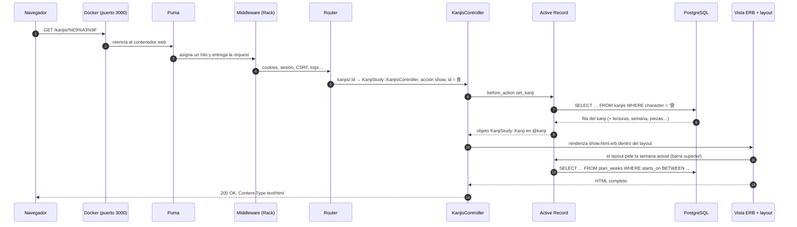

Paso a paso:

| # | Dónde | Qué pasa |
|---|---|---|
| 1–2 | Docker | El puerto 3000 de tu máquina está conectado al contenedor `web` (`docker-compose.yml`). |
| 3 | [Puma](https://puma.io) | El servidor web. Recibe la conexión y la atiende en uno de sus hilos. |
| 4 | Middleware | Una cadena de capas ([Rack](https://github.com/rack/rack)) por la que pasa toda request: sirve archivos estáticos, lee cookies y sesión, verifica el token CSRF de los formularios, registra en el log. Se pueden ver con `bin/rails middleware`. |
| 5 | Router | Compara la URL con las rutas. `/kanjis/食` coincide con `resources :kanjis` (en `packs/kanji_study/config/routes/kanji_study.rb`), así que `params[:id] = "食"`. Se pueden ver con `bin/rails routes`. |
| 6–9 | Controlador y modelo | `set_kanji` busca el kanji con Active Record, que traduce Ruby a SQL. Con `includes(...)` trae también sus lecturas, semana y piezas, en pocas consultas. |
| 10–13 | Vista | Rails renderiza la plantilla de la acción (`show.html.erb`) y la mete dentro del layout (`application.html.erb`), que agrega sidebar, barra superior y avisos. |
| 14 | Respuesta | HTML completo con estado `200 OK`. |

Así se ve esa misma request en el log real del servidor (abreviado):

```text
Started GET "/kanjis/%E9%A3%9F" for 172.18.0.1
Processing by KanjiStudy::KanjisController#show as */*
  Parameters: {"id" => "食"}
  KanjiStudy::Kanji Load (0.4ms)  SELECT "kanjis".* FROM "kanjis" WHERE "kanjis"."character" = '食' LIMIT 1
  KanjiStudy::KanjiReading Load (0.5ms)  SELECT "kanji_readings".* … WHERE "kanji_readings"."kanji_id" = 45 …
  PlanWeek Load (0.6ms)  SELECT "plan_weeks".* FROM "plan_weeks" WHERE "plan_weeks"."id" = 3
  …
  Rendering packs/kanji_study/app/views/kanji_study/kanjis/show.html.erb within layouts/application
  Rendered layouts/_sidebar.html.erb (Duration: 1.3ms)
  PlanWeek Load (0.6ms)  SELECT "plan_weeks".* … WHERE "plan_weeks"."starts_on" BETWEEN '2026-11-11' AND '2026-11-17' …
  ↳ app/views/layouts/_topbar.html.erb:21
  Rendered layout layouts/application.html.erb (Duration: 21.0ms)
Completed 200 OK in 411ms (Views: 29.9ms | ActiveRecord: 16.6ms (8 queries, 0 cached))
```

---

## 3. Cómo se arma el HTML

Rails no devuelve una plantilla: la **ejecuta**. Cada `<%= … %>` se evalúa en Ruby y su
resultado (escapado, para que no se pueda inyectar HTML) se escribe en la salida.

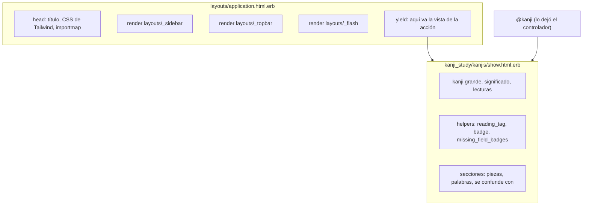

- **Variables de instancia:** lo que el controlador asigna (`@kanji`) queda disponible en la vista.
- **Layout:** el marco común de todas las páginas. `yield` marca dónde va la vista de la acción;
  `content_for :title` y `content_for :breadcrumbs` permiten que la vista rellene partes del layout.
- **Partials:** trozos reutilizables (`_sidebar`, `_kanji`, `_reading_fields`). Se renderizan con
  `render` y reciben datos como *locals*.
- **Helpers:** métodos de Ruby para la vista (`badge`, `date_range`, `reading_tag`), en `app/helpers`
  o en el `app/helpers` de cada pack.

Ejemplo de entrada y salida:

```erb
<%# show.html.erb %>
<h1><%= @kanji.meaning_es || "Sin significado" %></h1>
<%= badge "sabido", tone: :accent if @kanji.known? %>
```

```html
<!-- lo que llega al navegador -->
<h1>comer, comida</h1>
<span class="inline-flex items-center rounded-sm px-2 … text-shu">sabido</span>
```

---

## 4. Qué hace el navegador con ese HTML

El navegador recibe texto HTML y lo convierte en lo que ves:

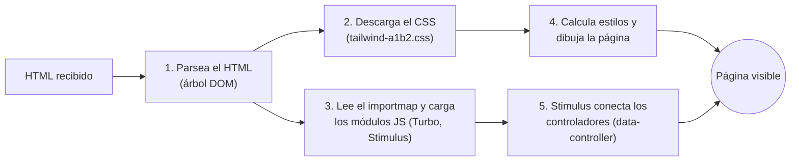

1. **DOM:** el HTML se convierte en un árbol de elementos.
2. **CSS:** el `<link>` del `<head>` apunta a un único archivo con todas las clases de Tailwind
   que usa la app (ver [sección 10](#10-css-y-javascript-de-dónde-salen)).
3. **JavaScript:** un `<script type="importmap">` le dice al navegador dónde está cada módulo;
   `application.js` importa Turbo y Stimulus.
4. **Dibujo:** con el DOM y el CSS, el navegador calcula posiciones y pinta. Las fuentes
   Noto se descargan de Google Fonts.
5. **Stimulus:** busca los elementos con `data-controller="…"` y les conecta su controlador.

En la **primera visita** pasa todo esto. En las siguientes, Turbo evita repetir casi todo.

---

## 5. Turbo Drive: navegar sin recargar

Sin Turbo, cada clic en un link descarga la página nueva y el navegador **descarta todo**:
vuelve a cargar CSS y JS, vuelve a dibujar desde cero y se ve un parpadeo. Turbo Drive
intercepta los clics y lo hace mejor:

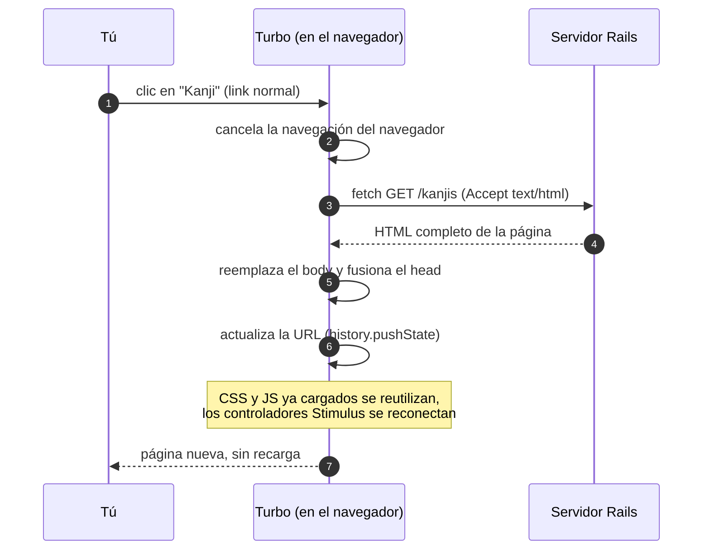

- **El servidor no se entera** de que es Turbo: responde la misma página HTML de siempre.
- **El sidebar no "parpadea"** al navegar. Su estado colapsado se guarda en una cookie, así que
  el servidor ya lo renderiza colapsado (`data-collapsed` en el `<body>`).
- **Barra de progreso:** si la respuesta tarda, Turbo muestra una barra fina arriba.

---

## 6. Formularios: guardar, redirigir o mostrar errores

Turbo también envía los formularios con `fetch`. El controlador decide qué responder:

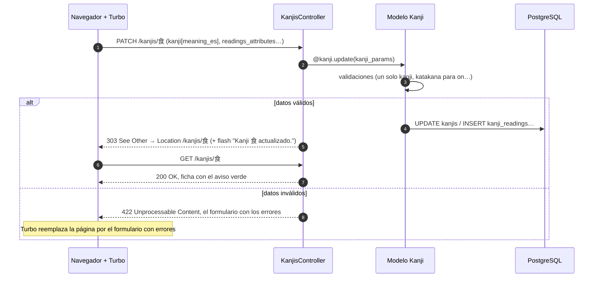

- **`params.expect(…)`** solo deja pasar los campos permitidos (protección contra *mass assignment*).
- **Token CSRF:** cada formulario incluye un token oculto que el middleware verifica; una página
  ajena no puede enviar formularios en tu nombre.
- **Redirigir tras guardar** (patrón PRG, Post/Redirect/Get) evita que recargar la página
  reenvíe el formulario.
- **`422`** le dice a Turbo que no hubo redirección y que muestre el HTML de respuesta (el
  formulario con errores).

---

## 7. Turbo Frames: reemplazar una parte

Un `<turbo-frame id="…">` es una región de la página que se actualiza sola. Ejemplo: el
filtro por semana del listado de kanji.

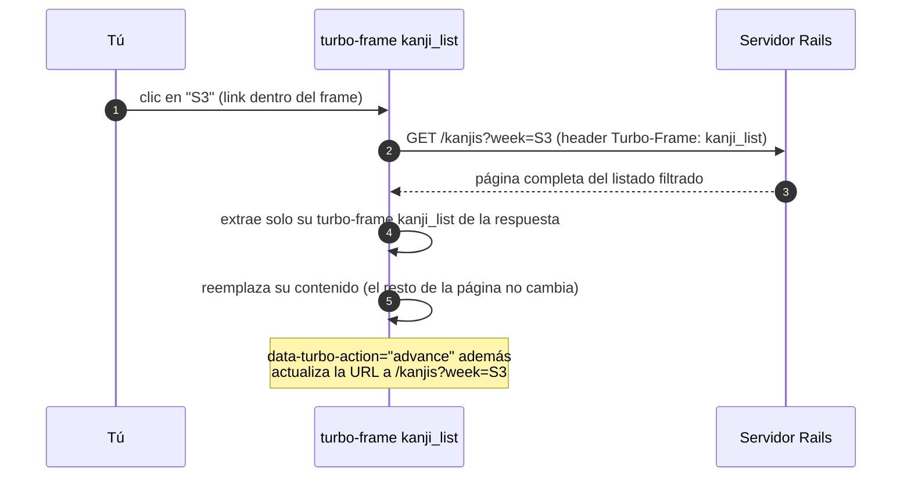

- El servidor **responde la página entera** (la misma acción `index`); es Turbo quien recorta
  el frame. Así la URL `/kanjis?week=S3` también funciona si la abres directamente.
- Un link dentro del frame que deba cambiar toda la página lleva `data-turbo-frame="_top"`.
- La búsqueda de palabras usa lo mismo: un formulario GET apuntando al frame `words_list`,
  enviado por el controlador Stimulus `search` mientras escribes.

---

## 8. Turbo Streams: varias actualizaciones en una respuesta

A veces una acción debe actualizar **varias partes sueltas** de la página. Ejemplo: al marcar
un kanji como sabido cambian su ficha, el contador de su semana y el contador total.

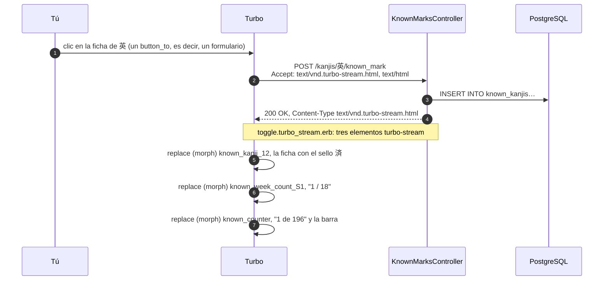

La respuesta no es una página: es una lista de instrucciones.

```html
<turbo-stream action="replace" method="morph" target="known_kanji_12">
  <template><div id="known_kanji_12"> …ficha con el sello 済… </div></template>
</turbo-stream>
<turbo-stream action="replace" method="morph" target="known_counter">
  <template><div id="known_counter"> …1 de 196… </div></template>
</turbo-stream>
```

- **Cómo sabe el controlador qué responder:** Turbo agrega `text/vnd.turbo-stream.html` al
  header `Accept`, y `respond_to { |f| f.turbo_stream; f.html { redirect… } }` elige. Sin
  JavaScript, la misma acción responde con una redirección normal.
- **`method="morph"`:** en vez de cambiar el elemento por uno nuevo, Turbo compara y modifica
  solo lo distinto. Por eso se conserva el foco del teclado y la barra de progreso anima su ancho.
- **Animación del sello:** el `<span>` del 済 es un elemento nuevo en el DOM, así que su
  transición `starting:` (CSS `@starting-style`) se dispara al aparecer.

---

## 9. Stimulus: el JavaScript de cada componente

Para lo que necesita responder **al instante, sin ir al servidor** (abrir un menú, agregar
una fila al formulario), se usa un controlador de Stimulus, conectado desde el HTML.

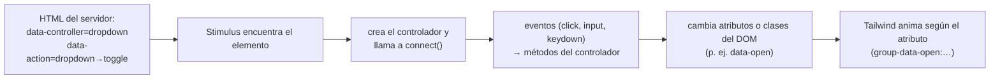

```erb
<div data-controller="dropdown" class="group/menu">
  <button data-action="dropdown#toggle" data-dropdown-target="button">私</button>
  <div class="opacity-0 group-data-open/menu:opacity-100"> …menú… </div>
</div>
```

```js
// app/javascript/controllers/dropdown_controller.js
toggle() {
  this.element.hasAttribute("data-open") ? this.close() : this.open()
}
```

- **El HTML manda:** el controlador no genera la interfaz; solo reacciona a eventos y cambia
  atributos. El estilo de cada estado lo pone Tailwind.
- **Con Turbo:** al navegar, los elementos viejos desaparecen (`disconnect()`) y los nuevos
  se conectan (`connect()`) solos. No hay que inicializar nada a mano.

| Controlador | Para qué |
|---|---|
| `sidebar` | Colapsar en escritorio (y guardar la cookie), abrir y cerrar el cajón en móvil |
| `dropdown` | Menú de usuario |
| `flash` | Ocultar los avisos tras unos segundos |
| `search` | Enviar la búsqueda mientras escribes (con espera de 250 ms) |
| `nested-form` | Agregar y quitar lecturas en el formulario del kanji |
| `tokens` | Piezas como chips en el formulario del kanji |

---

## 10. CSS y JavaScript: de dónde salen

No hay Webpack, Vite ni Node. Hay dos piezas simples:

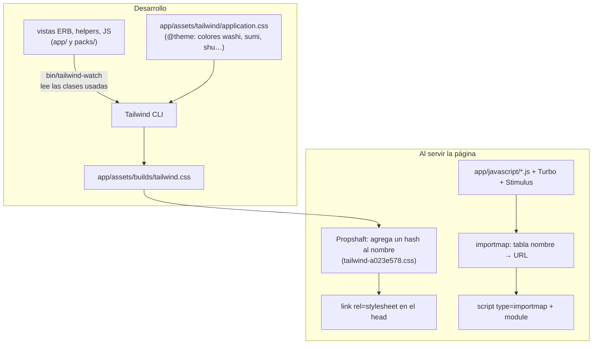

- **Tailwind:** revisa las vistas, helpers y JS de la app y de los packs, y genera un CSS solo
  con las clases que se usan. En desarrollo recompila cada vez que cambias un archivo.
- **Propshaft:** sirve los archivos de `app/assets` agregando un hash al nombre. Si el archivo
  cambia, cambia el nombre, y el navegador no usa una versión vieja de la caché.
- **importmap:** el navegador carga módulos ES directamente (`import { Controller } from
  "@hotwired/stimulus"`). El importmap traduce esos nombres a URLs. Los controladores de
  `app/javascript/controllers/` se registran solos.

---

## 11. Los packs dentro del flujo

Los packs cambian **dónde vive el código**, no cómo fluye la request. Al arrancar,
`packs-rails` agrega las carpetas de cada pack a las que Rails ya busca:

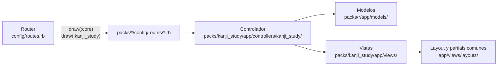

- **Autocarga:** cuando el código menciona `KanjiStudy::Kanji`, Zeitwerk (el cargador de Rails)
  busca `kanji_study/kanji.rb` en todas las carpetas `app/models`, incluidas las de los packs.
- **Vistas:** Rails busca `kanji_study/kanjis/show.html.erb` en todos los `app/views`.
- **Secciones entre packs:** al renderizar la página de una semana, la vista de `core` recorre
  `PlanWeekSections.all` y renderiza los partials que registró `kanji_study`. `core` no sabe
  qué hay dentro: solo dibuja lo que le registraron.

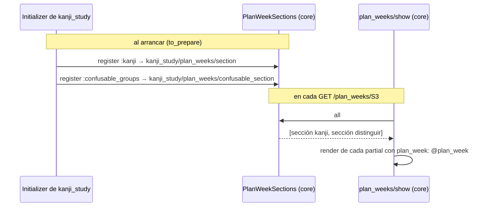

---

## 12. Cómo leer lo que pasa

| Quieres ver… | Dónde |
|---|---|
| Qué controlador atendió una request, sus consultas y vistas | El log: `docker compose logs -f web` |
| Qué ruta corresponde a una URL | `docker compose run --rm web bin/rails routes -g kanji` |
| Las capas de middleware | `docker compose run --rm web bin/rails middleware` |
| Si una request la hizo Turbo y qué respondió | Herramientas del navegador (F12) → **Red** → la request → headers `Accept` y `Turbo-Frame`, y la respuesta |
| Qué HTML generó el servidor | Clic derecho → **Ver código fuente** (el HTML original) |
| El DOM después de Turbo y Stimulus | F12 → **Elementos** (el DOM actual, con `data-open`, etc.) |
| Probar código Ruby contra los datos | `docker compose run --rm web bin/rails console` |

Pistas para leer el log:

- `Processing by KanjiStudy::KanjisController#show as */*`: la acción que respondió y el
  formato pedido. En una marca de sabido se ve `as TURBO_STREAM`.
- Cada línea `… Load (0.4ms) SELECT …` es una consulta. Si aparecen decenas iguales con
  distinto `id`, es un problema N+1: falta un `includes`.
- `↳ app/views/layouts/_topbar.html.erb:21` indica qué línea de código lanzó la consulta.
- `Completed 200 OK in 411ms (Views: 29.9ms | ActiveRecord: 16.6ms (8 queries…))`: el
  resultado y en qué se fue el tiempo.
