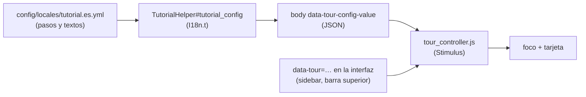

# Tutorial e i18n

Cómo funciona el tutorial de la app (el recorrido guiado), cómo cambiar sus pasos y cómo
agregar otro idioma con **i18n** (*internationalization*: preparar la app para varios
idiomas). Hoy el tutorial está en español; está listo para sumar inglés.

## Qué es el tutorial

Un recorrido sobre la interfaz: oscurece la pantalla, resalta un elemento (una sección del
sidebar, el atajo a la semana actual, el menú) con un foco animado y muestra al lado una
tarjeta que explica para qué sirve.

- **Cuándo aparece:** la primera vez que se entra al inicio, después de la animación de おかえり.
  Que ya se vio se guarda en el navegador (`localStorage`, clave `tutorial:v1:done`).
- **Volver a verlo:** menú 私 → **Ver tutorial**.
- **Teclado:** → o Enter avanza, ← retrocede, Esc cierra.
- **En móvil** el sidebar está oculto: los pasos que lo resaltan muestran la tarjeta centrada.

## Cómo está armado



| Pieza | Dónde | Qué hace |
|---|---|---|
| Textos y pasos | [`config/locales/tutorial.es.yml`](../config/locales/tutorial.es.yml) | La lista de pasos (`key`, `target`, `title`, `body`) y los textos de los botones. |
| Helper | [`app/helpers/tutorial_helper.rb`](../app/helpers/tutorial_helper.rb) | Lee los pasos con `I18n.t` en el idioma actual y decide si arranca solo (solo en el inicio). |
| Layout | `app/views/layouts/application.html.erb` | Pone en el `<body>` el controlador `tour` con los pasos en JSON. |
| Controlador | [`app/javascript/controllers/tour_controller.js`](../app/javascript/controllers/tour_controller.js) | Dibuja el foco y la tarjeta, navega entre pasos, guarda que se vio. **No tiene textos propios**: todo viene del archivo de traducción. Inserta los textos con `textContent`, nunca como HTML. |
| Elementos resaltables | `data-tour="…"` en `_sidebar.html.erb` y `_topbar.html.erb` | Cada sección del sidebar usa la `key` de su `NavItem` (`plan`, `pending`, `kanji`…). |

## Cambiar o agregar un paso

1. Si el paso resalta algo nuevo, ponle al elemento un atributo `data-tour="mi_elemento"`.
2. Agrega el paso en `tutorial.es.yml`, en el lugar del orden que corresponda:

   ```yaml
   - key: mi_paso
     target: mi_elemento   # opcional: sin target, la tarjeta va centrada
     title: Título del paso
     body: >-
       Texto del paso. Puede ocupar
       varias líneas.
   ```

3. Si el paso tiene que volver a mostrarse a quien ya vio el tutorial, cambia la versión de
   la clave en `tour_controller.js` (`tutorial:v1:done` → `tutorial:v2:done`).
4. Corre los tests: `test/integration/tutorial_test.rb` verifica que cada paso tenga título y
   texto y que cada `target` exista en la interfaz.

## Agregar inglés

1. **Traducir:** copia `config/locales/tutorial.es.yml` como `tutorial.en.yml`, cambia la
   primera línea `es:` por `en:` y traduce `title`, `body`, `open` y `controls`. **No
   traduzcas** `key` ni `target`.
2. **Habilitar el idioma** en `config/application.rb`:

   ```ruby
   config.i18n.available_locales = [ :es, :en ]
   ```

   Para las traducciones base de Rails en inglés (fechas, validaciones) no hace falta nada
   más: vienen con Rails (y `rails-i18n` trae las del español).
3. **Elegir el idioma en cada request.** Hoy la app siempre usa el idioma por defecto
   (`:es`). Una forma simple, en `ApplicationController`:

   ```ruby
   around_action :switch_locale

   def switch_locale(&action)
     locale = params[:locale].presence_in(I18n.available_locales.map(&:to_s)) || I18n.default_locale
     I18n.with_locale(locale, &action)
   end
   ```

   Y luego guardar la elección (cookie o, cuando haya usuarios, en sus preferencias).
4. **Test:** agrega a `tutorial_test.rb` un caso con `I18n.with_locale(:en)` que verifique
   que todos los pasos tienen texto.

### Hasta dónde llega hoy el i18n

Están en archivos de traducción el **tutorial**, los **nombres de modelos y atributos**, los
**mensajes de validación** y algunos textos de dominio (tipos de lectura, modos de práctica,
estados y tipos de tarjeta). **El resto de las pantallas tiene los textos escritos en español
directamente en las vistas.** Traducir toda la app requeriría moverlos a archivos de
traducción (`t(".titulo")` en cada vista); se puede hacer pantalla por pantalla cuando haga
falta.
